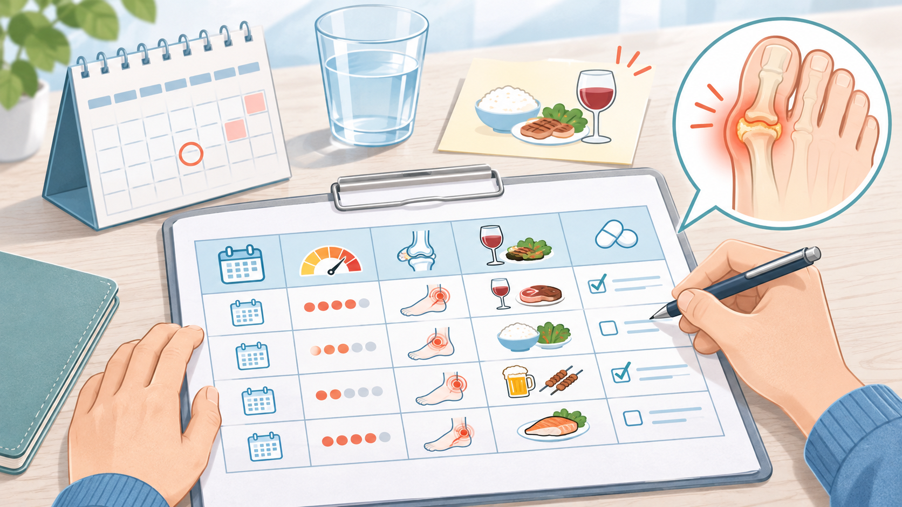

*이 그림에서 볼 부분은 날짜별 통증 강도, 관절 부위, 음주·식사와 복용약을 한 줄에 연결해 기록하는 구조다.*

통풍이 의심되거나 이미 진단받은 사람이 진료 전 7일 동안 발작의 시작 시각·관절 부위·붓기와 열감·음주와 식사·복용약을 함께 적으면 진료 대화가 구체적으로 바뀐다. 반대로 갑자기 심하게 붓고 빨갛고 뜨거운 관절이 생겼다면 기록을 채우느라 기다릴 상황이 아니다. 감염성 관절염 등 다른 원인도 구분해야 하므로 빠르게 의료기관에 연락해야 한다. 진단과 치료는 의사와 상담해야 한다.

## 통풍 진료에서 기록이 필요한 이유

질병관리청은 통풍 병력을 확인할 때 증상의 발생 시기와 부위, 심한 정도와 기간, 과거 병력, 복용 중인 약물, 악화 요인을 살핀다고 안내한다. 혈중 요산이 높다는 사실만으로 통풍을 확정할 수 없다는 점도 함께 설명한다. 따라서 “요산 수치가 높았다” 한 줄보다 실제 발작의 양상을 날짜별로 남기는 편이 유용하다.

| 기록 항목 | 적는 방식 | 진료 때 확인할 질문 |
|---|---|---|
| 시작과 지속 | 시작 시각, 끝난 날짜, 밤에 시작했는지 | 갑자기 시작했나, 며칠 지속됐나 |
| 관절 상태 | 엄지발가락·발목·무릎 등, 한 곳인지 여러 곳인지 | 붓기·발적·열감·압통이 있었나 |
| 통증 변화 | 0~10점, 걷기 가능 여부 | 일상생활을 얼마나 막았나 |
| 생활 요인 | 24~48시간 전 음주, 가당 음료, 육류·내장류, 수분 섭취 | 특정 요인 뒤 반복되나 |
| 약과 검사 | 약 이름·복용 시간·누락, 최근 요산·신장검사 날짜 | 약을 바꾸거나 끊은 시점이 있나 |

## 복사해서 쓰는 7일 기록지

아래 양식을 메모 앱이나 종이에 복사한다. 음식은 “고기”처럼 뭉뚱그리지 말고 내장류, 붉은 고기, 해산물, 가당 음료, 술의 종류와 양을 가능한 범위에서 적는다. 양을 정확히 모르면 잔 수나 캔 수처럼 다시 떠올릴 수 있는 단위만 써도 된다.

```text
날짜 / 기록 시각:
통증이 시작된 시각과 지속 시간:
아픈 관절과 좌우:              한 곳 / 여러 곳
통증 0~10점:                   걷기·잠·업무 영향:
붓기·빨갛게 됨·열감·눌렀을 때 아픔:
지난 24~48시간 음주·가당 음료·식사:
물 섭취가 평소와 달랐는지:
복용한 약 이름·시간·누락 여부:
발열, 상처, 최근 외상 또는 감염 증상:
오늘 의사에게 물을 질문:
```

증상이 없는 날도 “발작 없음, 복용약 동일”이라고 남긴다. 그러면 발작이 며칠 간격으로 반복되는지와 생활 변화 시점을 비교하기 쉽다. 통풍 생활 관리는 음식을 무조건 금지하는 방식으로 단순화하기 어렵다. 질병관리청은 엄격한 식이 제한만으로는 혈중 요산 감소 폭과 지속성이 제한적이라고 설명하면서, 과도한 음주와 가당 음료·내장류를 피하고 균형 잡힌 식사, 충분한 수분, 규칙적인 운동과 적정 체중을 권고한다. 개인의 신장 기능과 복용약에 따라 기준이 달라질 수 있으므로 식단을 크게 바꾸기 전 진료 기록과 함께 상담한다.

## 바로 진료를 서둘러야 하는 경우

| 상황 | 행동 |
|---|---|
| 갑자기 심한 통증과 붓기·발적·열감이 생김 | 움직임을 줄이고 빠르게 의료기관에 연락한다 |
| 관절 증상과 함께 열이 나거나 상처·감염 가능성이 있음 | 통풍으로 단정하지 말고 당일 평가를 받는다 |
| 발작이 반복되거나 기간이 길어짐 | 발작 날짜와 복용약 목록을 지참해 진료한다 |

질병관리청은 급성 통풍 발작 때 안정을 취하고 얼음찜질을 하면서 빠르게 병원을 방문하라고 안내한다. 기존 요산강하제나 진통제를 임의로 중단·추가하지 말고, 기록지에는 실제로 복용한 약만 적는다. 기록은 진단을 대신하는 도구가 아니라 의사가 증상과 생활 요인을 함께 판단하도록 돕는 자료다.

참고한 공식 자료는 [질병관리청 국가건강정보포털의 통풍 안내](https://health.kdca.go.kr/healthinfo/biz/health/gnrlzHealthInfo/gnrlzHealthInfo/gnrlzHealthInfoView.do?cntnts_sn=6732)와 [미국 국립 관절염·근골격·피부질환 연구소의 통풍 안내](https://www.niams.nih.gov/ko/health-topics/tongpung?sid=60ELLb)다. 2026년 11월 18일 확인했다.
